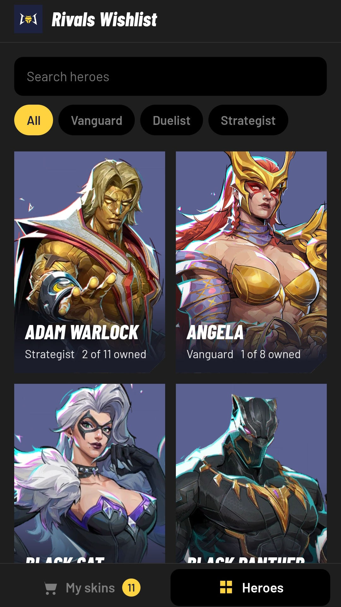
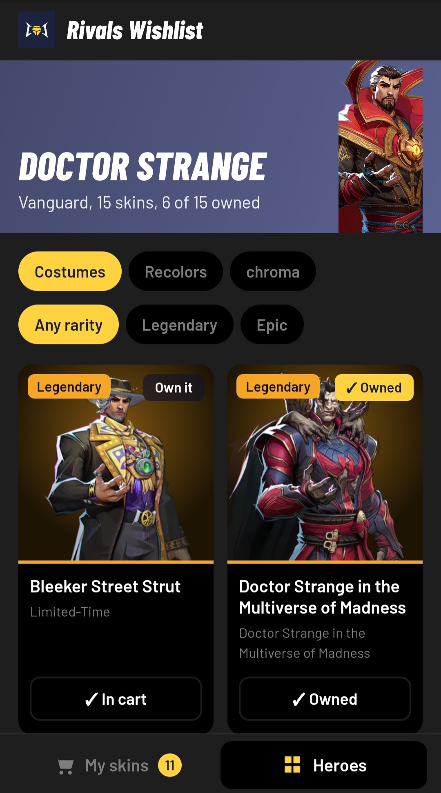
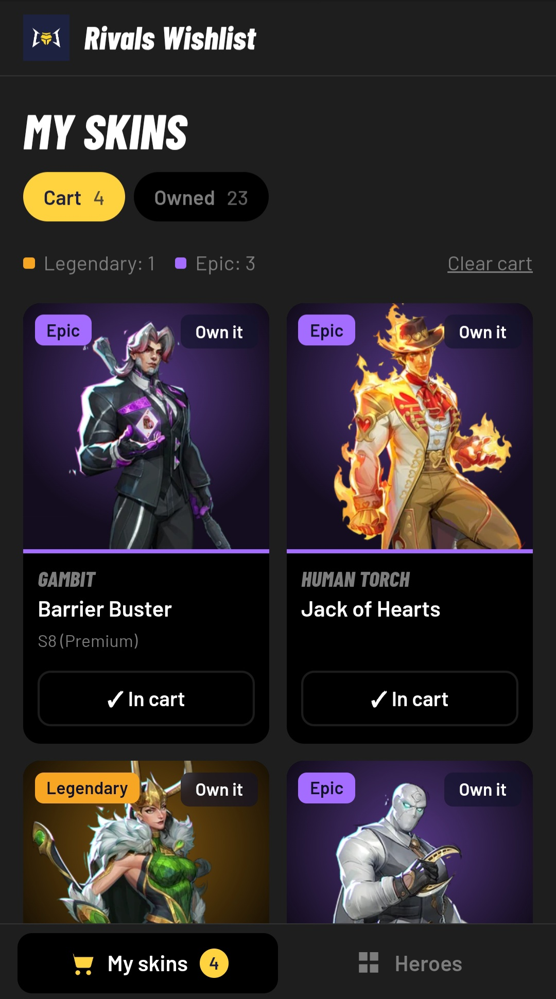

# Rivals Wishlist — Telegram Mini App


A Telegram Mini App with every **Marvel Rivals** skin. Browse skins by hero, add the ones you want to buy to a cart, and mark the ones you already own. Your lists sync across devices through your Telegram account.

<p align="center">
  
  
  
</p>


## Features

- **Full skin catalog.** 50+ heroes and almost 700 skins with rarity, theme, source and artwork, split into costumes and recolors.
- **Cart and "Owned" lists.** Saved in [Telegram CloudStorage](https://core.telegram.org/bots/webapps#cloudstorage), so they follow the user across devices. In a regular browser they fall back to `localStorage`.
- **Search and filters.** Filter heroes by name and role, and skins by rarity. Shows per-hero progress ("12 of 30 owned").
- **Native Telegram feel.** Uses the user's Telegram theme colors, the Back button, haptic feedback and native confirm dialogs.
- **Polish and English UI**, picked from the user's Telegram language.
- **Self-updating data.** A built-in scheduler refreshes skins daily and heroes monthly. It downloads only wiki templates that actually changed (usually 0–2 requests a day).
- **Zero-config Telegram hosting.** `docker compose up` starts the app with a free Cloudflare quick tunnel. Whenever the tunnel URL changes, the bot's menu button is updated automatically.

## How it works

```
Marvel Rivals Wiki (MediaWiki API)
        │  polite client: sequential requests, 1 s delay, maxlag, Retry-After
        ▼
 app/heroes.py, app/skins.py  ──►  data/*.json + data/images/   (local cache)
        ▲                                   │
 app/updater.py (scheduler)                 ▼
                                   app/main.py (FastAPI)  ──►  public/ (vanilla JS SPA)
                                                                     │
 app/telegram.py ── bot menu button + /start reply ──► Telegram ─────┘
```

- **Data source.** Skins are parsed from the `Template:COSMETICS - <Hero> Costumes` pages of the [Marvel Rivals Wiki](https://marvelrivals.fandom.com) with BeautifulSoup. A daily run asks for the latest revision ID of every template and re-parses only the ones that changed. Images are cached locally because Fandom blocks hotlinking.
- **Safety nets.** All writes are atomic (temp file + `os.replace`). A failed or suspicious update, such as the wiki layout changing and returning only 3 heroes, keeps the previous data and is retried an hour later. Missed runs, for example when the computer was off, are caught up on startup.
- **Frontend.** One dependency-free JS file with hash routing (`#/`, `#/heroes`, `#/hero/<id>`). It talks to a single endpoint, `GET /api/catalog`. The catalog is cached in memory and rebuilt only when the JSON files change.
- **Bot.** Uses long polling, so Telegram never needs to reach the tunnel. The bot token is never written to logs or error messages.

## Tech stack

**Backend:** Python 3.11+, FastAPI, httpx (async), BeautifulSoup, pydantic-settings
**Frontend:** vanilla JavaScript, CSS, Telegram WebApp SDK
**Infra:** Docker Compose, Cloudflare Tunnel, GitHub Actions
**Tests:** pytest, pytest-asyncio, httpx `MockTransport`, FastAPI `TestClient`

## Running locally

```bash
python -m venv .venv
source .venv/bin/activate          # Windows: .venv\Scripts\activate
pip install -r requirements.txt
cp .env.example .env               # Windows: copy .env.example .env
```

Put your e-mail or Telegram handle in `WIKI_CONTACT` in `.env`. The [MediaWiki API etiquette](https://www.mediawiki.org/wiki/API:Etiquette) asks for it in the User-Agent. Then run:

```bash
python -m app.update all           # first download, about 1–2 minutes
uvicorn app.main:app --port 8000
```

Open http://localhost:8000. Data status is at http://localhost:8000/api/status.

## Running in Telegram (Docker)

1. Create a bot with [@BotFather](https://t.me/BotFather) and put its token in `TELEGRAM_BOT_TOKEN` in `.env`.
2. Start the app and the tunnel:

   ```bash
   docker compose up -d --build
   docker compose logs -f app
   ```

3. After 30–60 s the log prints `Menu button "Skins" in @your_bot now opens https://….trycloudflare.com`. Open your bot in Telegram and tap the menu button.

The free quick tunnel gets a new address on every restart. The app updates the menu button by itself, but buttons in old messages stop working. For a permanent address, use your own domain with a named Cloudflare tunnel and set `PUBLIC_URL`.

## Configuration

| Variable | Default | Description |
|---|---|---|
| `WIKI_CONTACT` | — | Your contact, sent in the User-Agent to the wiki |
| `TELEGRAM_BOT_TOKEN` | empty | Bot token. Without it the app works in the browser only |
| `PUBLIC_URL` | empty | Permanent HTTPS URL. Empty means the Cloudflare quick tunnel is used |
| `MENU_BUTTON_TEXT` | `Skins` | Label of the bot's menu button |
| `REQUEST_DELAY` | `1.0` | Seconds between wiki API requests |
| `HEROES_DAY_OF_MONTH` | `15` | Day (1–28) when the hero list is refreshed |
| `SCHEDULER_ENABLED` | `true` | Turn off automatic updates |

## Manual data update

```bash
python -m app.update               # whatever is overdue
python -m app.update heroes        # heroes only
python -m app.update skins         # changed skins only
python -m app.update skins --full  # rebuild all skins
```

## Tests

```bash
pip install -r requirements-dev.txt
pytest
```

The tests cover HTML parsing against wiki-like fixtures, incremental skin updates and image cleanup, scheduler decisions, retry and back-off in the wiki client, the API, and the Telegram integration, including a check that the bot token never leaks into errors. Network access is mocked, so the suite runs offline in under a second.

## Project structure

```
app/
  main.py      FastAPI app: /api/catalog, /api/status, images, frontend
  updater.py   scheduler (monthly heroes, daily skins, catch-up after downtime)
  update.py    CLI for manual updates
  heroes.py    hero list from the "Heroes" wiki page
  skins.py     skins from "COSMETICS - <Hero> Costumes" templates
  wiki.py      polite MediaWiki API client
  storage.py   atomic JSON / file storage in data/
  telegram.py  bot: menu button with the Mini App URL, /start reply
  config.py    settings from .env
public/        frontend (index.html, app.js, style.css)
tests/         pytest suite with HTML fixtures
data/          downloaded data, created at runtime (not in git)
```

## Roadmap

- Skin prices (the price field on the wiki is still empty)
- Hosting with a permanent URL

## Credits

Game data and images come from the [Marvel Rivals Wiki](https://marvelrivals.fandom.com) under [CC BY-SA](https://creativecommons.org/licenses/by-sa/3.0/). They are downloaded at runtime and are not part of this repository.

This is a fan-made project, not affiliated with NetEase Games or Marvel.
